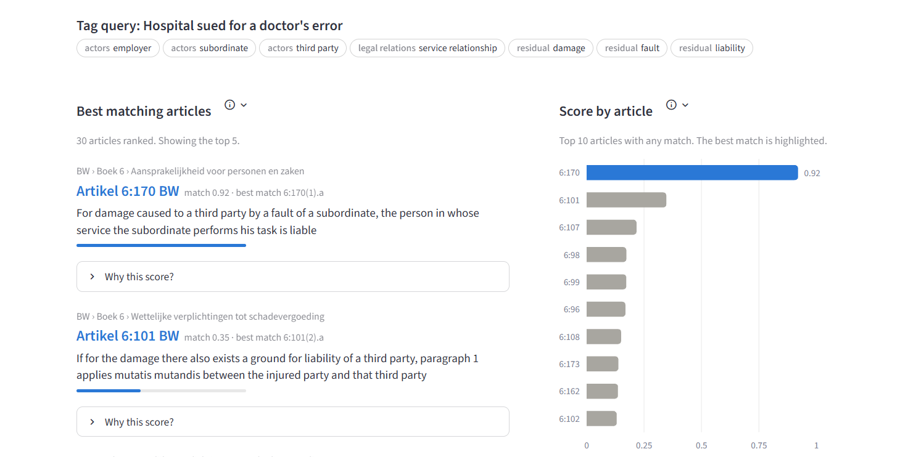
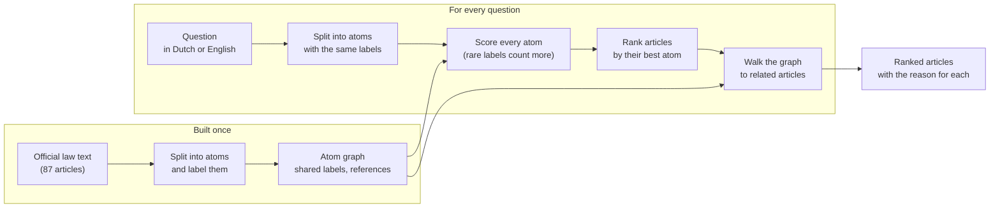
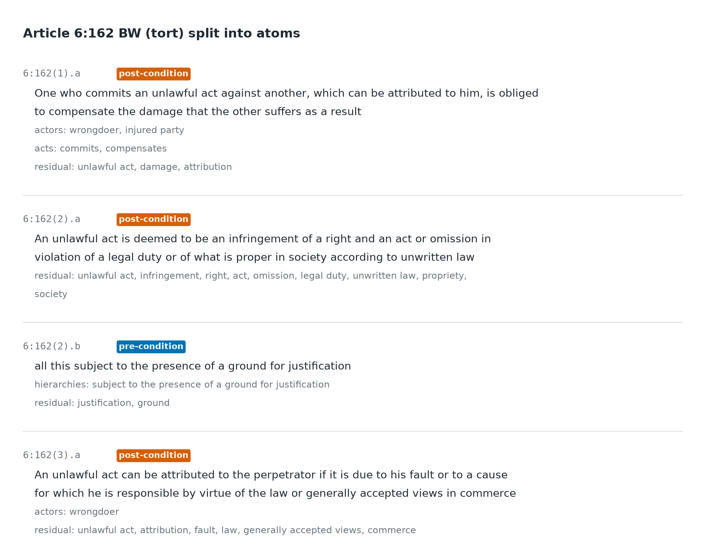
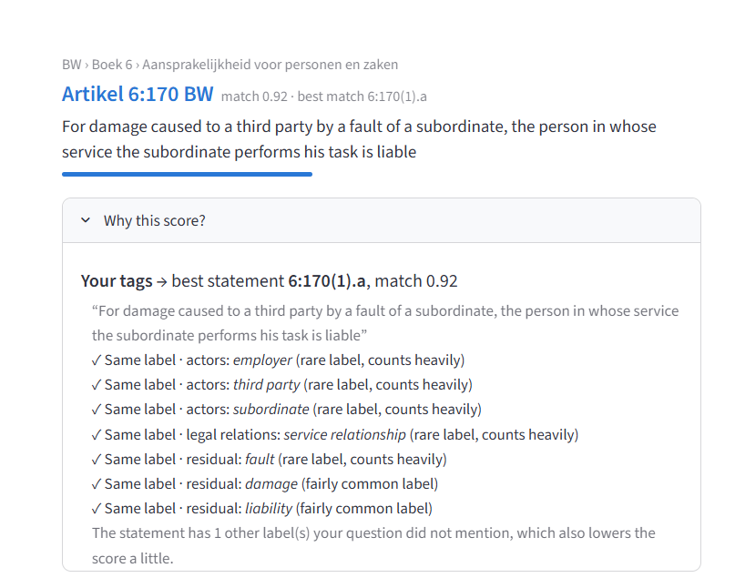
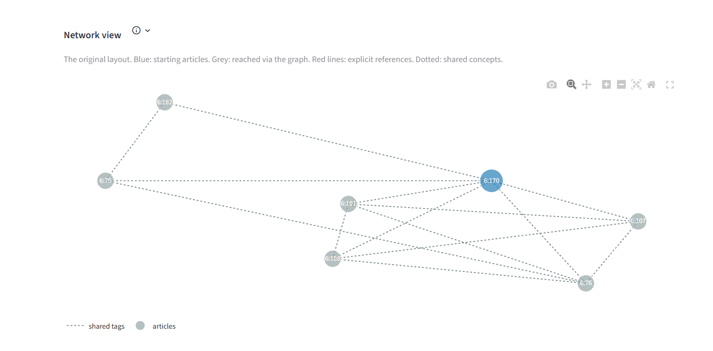
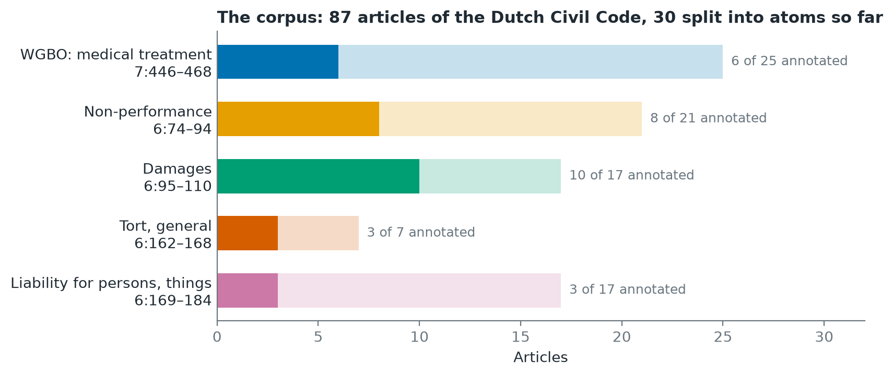
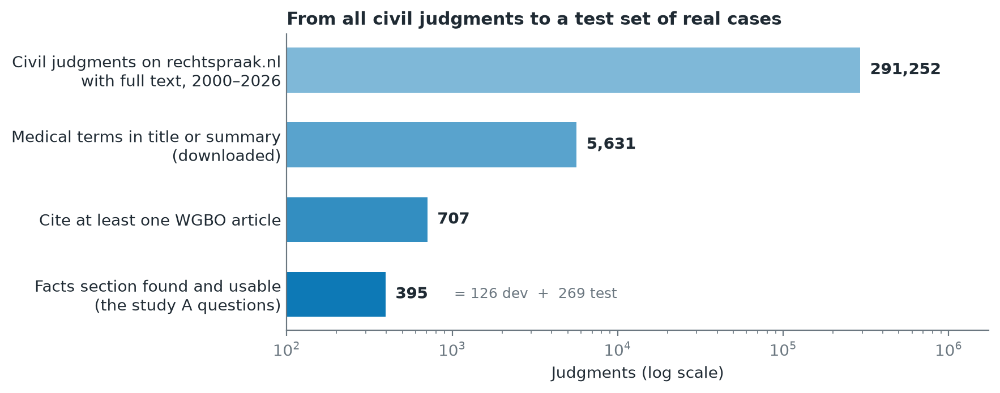
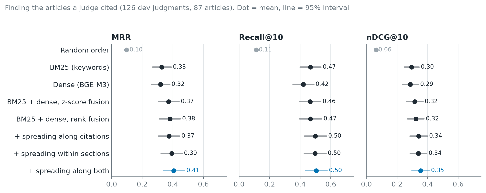
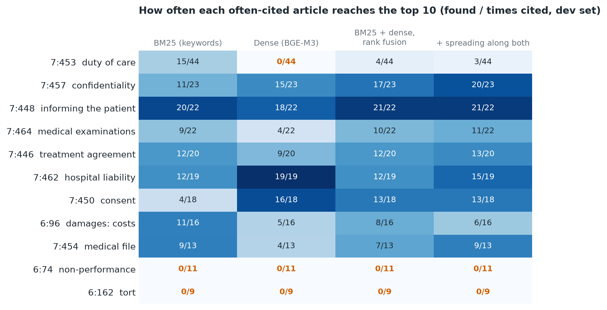
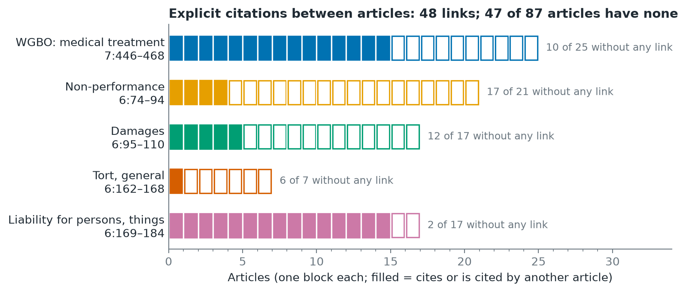

# Article Relationship Model
> **Status: work in progress.** The search baselines are evaluated.

Search Dutch statutory law with a plain-language question, and see **why**
each article was found.

Each article is split into the smallest pieces that carry one legal meaning
(*atoms*), every atom is labelled (who, what, under which condition), and
the atoms are connected into a graph. A question is matched to the specific
requirement it concerns, not to an article as one block of text.

The project covers medical liability: the WGBO (the medical treatment
agreement, Book 7 of the Dutch Civil Code, BW) and the Book 6 rules on
liability and damages that medical cases fall back on.

**Demo:** [Statute Navigator](https://statute-navigator.streamlit.app)
(password protected)

## How it works

An article as atoms. Each atom is a requirement (pre-condition) or a
consequence (post-condition), with labels for actors, acts, legal relations,
time, references and other key terms:

A question is split into atoms the same way by an LLM (Anthropic's Claude),
reusing the labels of the corpus. Two atoms score high when they share
labels, rare labels counting more; labels with the same meaning (*doctor* ~
*care provider*) also count. The app shows the match label by label:

From the best matches, a graph walk adds related articles and records which
link brought each one in:

More detail: [docs/methodology](docs/methodology/README.md).

## The corpus

87 articles of the Civil Code, downloaded from the government's official
XML. 30 of them have been split into atoms so far (80 atoms); only those can
be searched by atoms yet.

The atoms were drafted by an LLM and still need a check by hand. A small
made-up corpus (the "Lunar Medical Code") is used only in the tests.

## A test set from real court cases

Questions with known answers come from court judgments: the **facts of the
case** are the question, the **articles the judge cited** are the answer.
Article numbers in the facts are masked so they don't give the answer away.

The 395 questions are split once: **126 dev** for building and tuning,
**269 test** used once at the end. The test part has not been used yet.

## Results so far

**Standard search on the 126 dev questions** (no atoms yet). This is the bar
the atom system has to beat.

- **BM25** (keyword search) and **dense** (BGE-M3 embeddings) cannot be told
  apart.
- **Combining them** (rank fusion) puts the first correct article higher:
  MRR 0.38 vs 0.33 for BM25 (p = 0.04).
- **Spreading scores** to articles that cite each other or share a section
  of the law helps a little more: nDCG@10 0.32 → 0.35 (p = 0.004). Its
  settings were tuned on dev, so the test run decides.

*MRR: 1 / position of the first correct article. Recall@10: share of the
cited articles in the top 10. nDCG@10: how well all correct articles are
placed in the top 10.*

**The blind spots.** Some of the most cited articles are never found:

6:74 (non-performance) and 6:162 (tort) never reach the top 10, whatever the
system. They are short, abstract rules that share neither words nor obvious
meaning with the story of a case, and the law text links them to almost
nothing:

Finding them needs links the text does not state, such as shared actors,
acts and conditions. That is what the atom graph adds, and the next thing to
test.

**Atoms, tested on themselves.** Each of the 80 atoms in turn is the
question and the 30 annotated articles are ranked: MRR 0.61 (random 0.11,
best possible 0.86).

## Hand-checking the test set

The answers are every corpus article a judgment cites, including ones cited
only in passing. A sample of 50 judgments is checked by hand on a separate
page (`streamlit run handcheck.py`):

## Can it scale?

- **Law text:** the download reads the official XML, which covers all Dutch
  law. Adding another book of the BW is a one-line change.
- **Test data:** 291,252 civil judgments are already indexed. Dropping the
  medical filter would give test questions for any part of the BW, likely
  thousands, without labelling anything by hand.
- **Annotation:** an LLM can split and label thousands of articles cheaply;
  a hand-checked sample measures how far the drafts can be trusted.
- **Speed:** comparing a question with every atom is fast up to about
  100,000 atoms. Beyond that, a text search first picks a shortlist of
  articles and the atoms re-rank only those.
- **Labels:** the 80 atoms use 277 different labels, 199 only once. A larger
  corpus needs a standard list of labels, or atoms that mean the same thing
  will not match.

## Next steps

1. Build the annotation pipeline and annotate all 87 articles from the
   official text, with a hand-checked sample to measure agreement.
2. Add the atom scores and the atom graph on top of the baselines and compare.
3. Check the 50 sampled judgments by hand.
4. Run every system once on the test set, with the settings fixed on dev.
5. A qualitative study of alternative legal grounds on a few real cases.

**Known limitations:** the atoms are unchecked LLM drafts, some based on
older versions of the law; only 30 of the 87 articles are annotated; the
annotations are in English while the law and case law are Dutch.

## Repository

    app.py                      Statute Navigator (Streamlit)
    handcheck.py                Page for checking test-set judgments by hand

    docs/methodology/           One note per stage, with figures
    docs/                       Project overview, schemas, decisions log

    src/data/                   Law text, atoms, scoring, graph walk, case law
    src/similarity/             Baselines (BM25, dense, hybrid) and metrics
    src/graph/                  Score spreading over citation and section links

    scripts/
      fetch_statutes.py         Download and parse the law text
      fetch_caselaw.py          Find judgments citing the WGBO
      build_study_a.py          Judgments -> questions, answers, dev/test split
      run_eval.py               Atom evaluation (leave-one-out)
      run_baselines.py          Baselines and score spreading on study A
      sample_handcheck.py       Draw the hand-check sample
      make_figures.py           All figures in this README

    data/                       Annotations, processed law text and citations
    outputs/                    Result tables and figures
    notebooks/                  Exploration and experiments
    tests/test_pipeline.py      46 tests

## Setup

    python -m venv .venv
    .venv\Scripts\activate              # macOS/Linux: source .venv/bin/activate
    pip install -r requirements.txt

Typed questions in the app need an Anthropic API key in
`.streamlit/secrets.toml` (git-ignored):

    ANTHROPIC_API_KEY = "sk-ant-..."

From the repo root:

    streamlit run app.py                     # the app
    python -m unittest discover tests        # tests
    python scripts/run_baselines.py          # baselines on dev
    python scripts/make_figures.py           # figures
