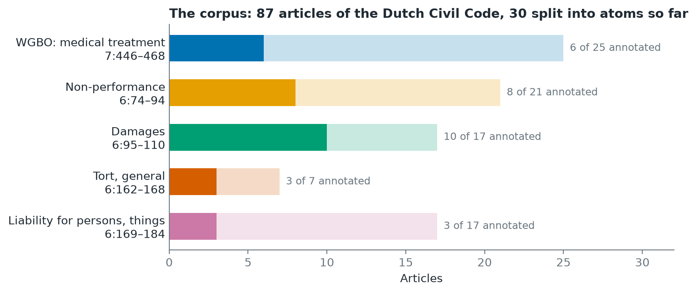
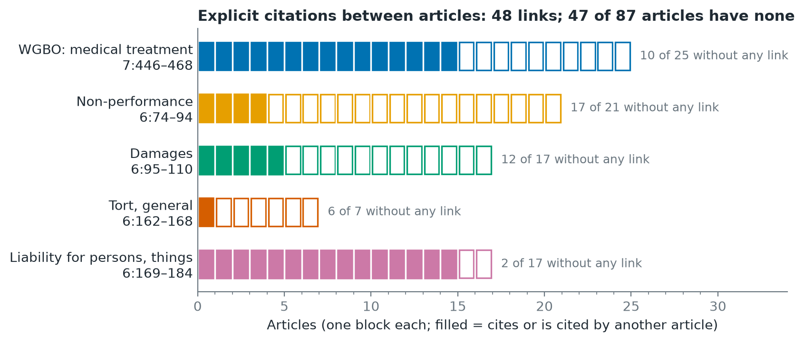

# 1. The corpus: 87 articles of the Dutch Civil Code

## What was done

`scripts/fetch_statutes.py` downloads the official consolidated XML of
BW Book 6 and Book 7 from the government's Basiswettenbestand (BWB) and
`src/data/statutes.py` turns it into one record per article:

- its place in the legal tree (boek > titel > afdeling > artikel);
- the date the current version took effect;
- the text per paragraph (lid);
- the cross-references it makes to other articles (the BWB `intref` elements).

The corpus covers one area of law, medical liability:

| Section | Articles | Why |
|---|---|---|
| WGBO, afd. 7.7.5 | 7:446–468 (25, incl. 7:458a, 7:458b) | The medical treatment agreement itself |
| Non-performance, afd. 6.1.9 | 6:74–94 | Contract liability, the fallback for a failed WGBO claim |
| Damages, afd. 6.1.10 | 6:95–110 | What can be claimed once liability is established |
| Tort, afd. 6.3.1 | 6:162–168 | Liability outside a contract |
| Liability for persons and things, afd. 6.3.2 | 6:169–184 | E.g. an employer liable for staff |

30 of the 87 articles were split into atoms earlier (see
[2. Atoms](02_atoms.md)); the rest are downloaded but not yet annotated.

## Explicit citations between articles

The law text itself links few articles. Of the 76 references the 87
articles make, 48 distinct pairs connect two corpus articles. **47 of the 87
articles cite no other corpus article and are cited by none.** Among them
are 6:162 (tort) and 7:453 (duty of care), two of the most cited articles
in case law.

The WGBO and the liability-for-persons section are well connected; the
general norms of Book 6 are not. Any method that only follows the law's own
references cannot reach them (see [5. Score spreading](05_score_spreading.md)).

## Checking the annotations against the official text

The same script compares every annotated atom with the official wording
(`outputs/tables/annotation_text_check.csv`):

- 61 of 80 atoms match word for word;
- 13 differ slightly (a different cut, repeated words);
- 6 differ substantially, either because the article was amended after
  annotation (7:454 in 2020, 7:457 in 2022, 6:106 in 2019) or because the
  annotated Dutch is not the statutory wording.

So the annotations need to be redone from the official text before they can
serve as ground truth.

## Key numbers

| | |
|---|---|
| Articles in the corpus | 87 |
| References made by these articles | 76 |
| Distinct citation links between corpus articles | 48 |
| Articles without any citation link | 47 |
| Versions used | Book 6: 2026-07-16_0, Book 7: 2026-07-01_1 (`data/raw/statutes/sources.json`) |
