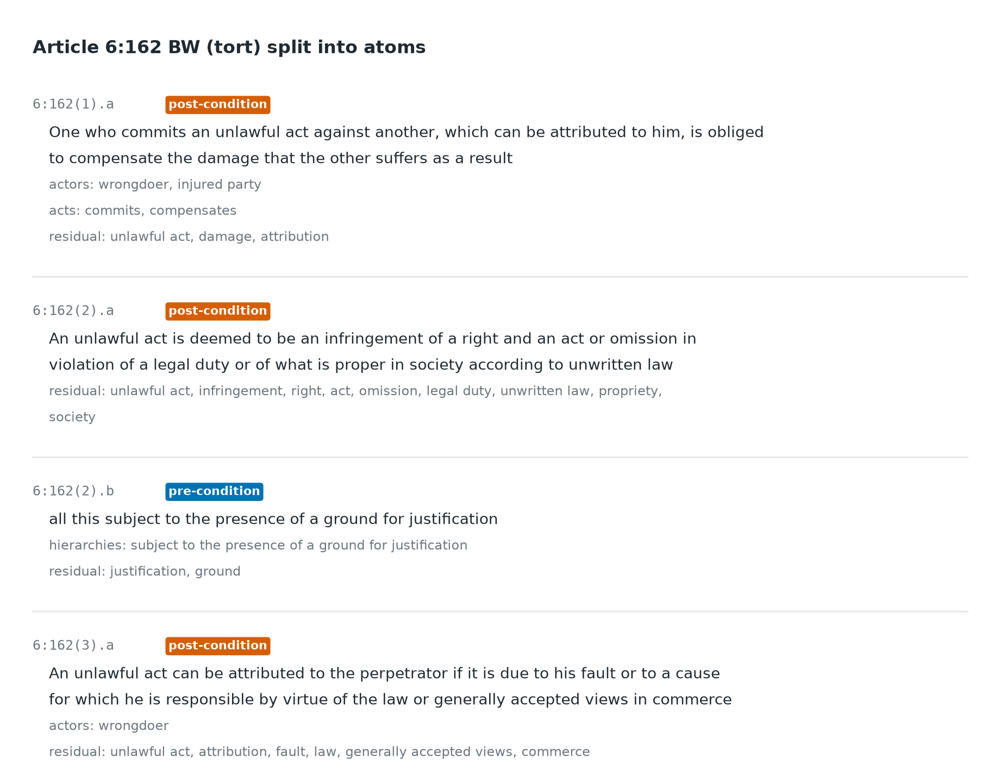

# 2. Atoms: splitting articles into labelled units

## What was done

Each annotated article is split into **atoms**: the smallest pieces of text
that carry a single legal meaning (one duty, one condition, one
consequence). Every atom is labelled with the lab's 9-label schema
([`docs/02_annotation_schema.md`](../02_annotation_schema.md)):

| Label | What it holds | In 6:162 |
|---|---|---|
| pre- or post-condition | Whether the atom is a requirement or a consequence | "subject to a ground for justification" is a pre-condition |
| actors | Who is involved | wrongdoer, injured party |
| legal relations | Rights and duties between actors | (none) |
| acts | What someone does | commits, compensates |
| geographical domain | Where the rule applies | (none) |
| temporal | Time limits and moments | (none) |
| explicit references | Other articles named in the text | (none) |
| hierarchies | How the atom ranks against other rules | "subject to the presence of a ground for justification" |
| residual | Other key terms | unlawful act, damage, attribution |

30 articles (6 from the WGBO, 24 from Book 6) were split into 80 atoms. The
atoms were drafted by an LLM and have not yet been checked by a human.

## Why atoms

An article usually stacks several requirements and consequences in one
paragraph. Treated as one block of text, it matches a question only as a
whole. Split into atoms, a question can be matched to the one requirement
it is about, and the match can be explained label by label.

## How atoms are compared

- Each label is weighted by its IDF: a label used by few atoms (e.g.
  *medical file*) counts more than one used by many (e.g. *patient*).
- Two atoms are compared with the IDF-weighted cosine (Ochiai) similarity
  of their label sets: 0 = nothing in common, 1 = identical labels.
- Labels that are not identical but mean the same (e.g. *doctor* and *care
  provider*) are matched through sentence embeddings, with the same
  weights.
- An article scores as its best-matching atom.

The pre/post-condition label is recorded but not yet used in scoring.

## Evaluation: leave-one-out

Each of the 80 atoms in turn is used as the query; IDF is recomputed
without it, and the system ranks the 30 articles. A hit means the atom's
own article is ranked high.

| | MRR | hit@1 | hit@3 | hit@10 |
|---|---|---|---|---|
| Random ranking | 0.11 | 0.03 | 0.09 | 0.29 |
| Unnormalised scoring | 0.59 | 0.45 | 0.71 | 0.83 |
| **Normalised scoring (default)** | **0.61** | **0.49** | **0.73** | **0.82** |

- 11 of the 30 articles have a single atom and cannot be found once it is
  held out, so the best possible score is 0.86.
- Semantic similarity alone scores MRR 0.23, close to random: exact label
  matches carry most of the signal.
- Most errors are neighbouring articles in the same section.
- With 80 queries, differences of a few points are within noise.

This test only uses corpus atoms as questions. Real questions come from
case law ([3. Test set](03_case_law_test_set.md)).

Results: `outputs/tables/article_retrieval_*`, produced by
`scripts/run_eval.py`.
