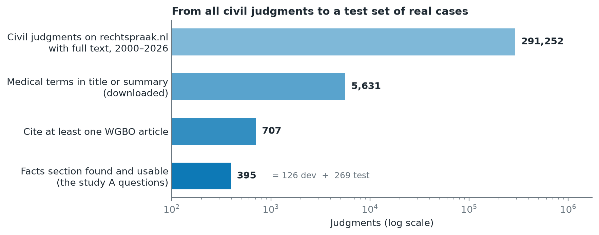

# 3. A test set from real court judgments (study A)

## Idea

To measure whether a system finds the right article, we need questions with
known answers. Court judgments provide both: the **facts of the case** are
the question, and the **articles the judge cited** are the answer. No one
has to label anything by hand.

## What was done

`scripts/fetch_caselaw.py` searches the open data of the Dutch judiciary
(rechtspraak.nl); `scripts/build_study_a.py` turns the judgments into
question–answer pairs.

1. **Index** all 291,252 published civil judgments with full text
   (2000–2026).
2. **Download** the 5,631 with medical terms in the title or summary and
   extract every BW article they cite.
3. **Keep** the 707 that cite at least one WGBO article (289 cite two or
   more; 188 also cite a Book 6 article in the corpus). 23 of the 25 WGBO
   articles are cited at least once.
4. **Find the facts section** ("De feiten", or a numbered heading such as
   "2. De feiten"). 254 judgments have none that can be found; 58 have a
   facts section under 80 words, often only "the facts as established by
   the court below". **395 remain.**

The keyword filter in step 2 misses little: none of 1,000 randomly checked
other judgments cites the WGBO.

## Masking the answer

Judges often name the article in the facts ("the patient relies on
article 7:453 BW"). That would give the answer away, so every statutory
reference in a question is replaced by `[ARTIKEL]`, and "WGBO" by `[WET]`.
73 questions contained such references; after masking, no cited corpus
article can be found in any question. Clock times such as "19:20 uur" are
left alone.

## Dev and test

The 395 questions are split once, by a fixed hash:

- **dev, 126 questions:** used to develop and tune systems;
- **test, 269 questions:** used once, at the end, with every setting fixed.

Judgments about the same case (first instance and appeal) always land on
the same side, so a system cannot learn a case on dev and meet it again on
test. The split is stored in `data/processed/study_a/split.csv` and stays
fixed when the script is re-run.

## Key numbers

| | |
|---|---|
| Questions | 395 (126 dev, 269 test) |
| Question length | median 656 words (80–4,788) |
| Correct articles per question | 1 for 158 questions, 2–9 for the rest |
| Corpus articles that occur as an answer | 49 of 87 |
| Most frequent answers | 7:453 (127), 7:446 (91), 7:457 (68), 7:448 (65), 7:462 (65) |

Counts: `outputs/tables/study_a_dataset_summary.json`.

## Limits

- The answer is every corpus article the judgment cites, including ones
  cited only in passing. A sample of 50 judgments (35 dev, 15 dropped,
  never test) is fixed in `data/validation/handcheck_sample.csv` for a check
  by hand with `streamlit run handcheck.py`.
- Hoge Raad judgments rarely have a separate facts section and are mostly
  lost in step 4.
