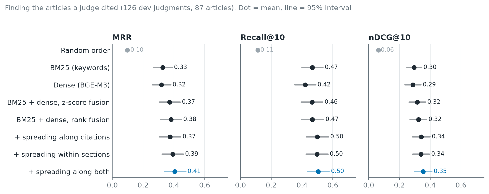
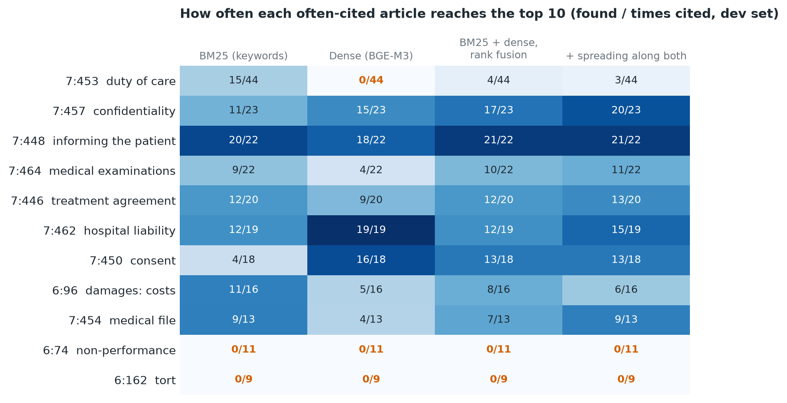

# 4. Baselines: standard search without atoms

## Why

Before adding atoms, we need to know how well ordinary search methods do on
the same questions. That is the bar the atom system has to beat.

## Systems

All systems rank the 87 articles for each of the 126 dev questions, using
the article text only (no number, no heading).

| System | How it works |
|---|---|
| Random | Articles in random order (average over 100 orders) |
| BM25 | Keyword search: rare words shared by question and article count most |
| Dense | Question and article each become one vector (BGE-M3, multilingual, up to 8,192 tokens); rank by cosine |
| Hybrid, z-score | Standardise BM25 and dense scores per question and add them |
| Hybrid, rank fusion (RRF) | Add 1/(60 + rank) from each system; no tuning |

## Metrics

- **MRR:** 1 / position of the first correct article, averaged over
  questions.
- **recall@k:** share of the cited articles that are in the top k.
- **nDCG@10:** how well all correct articles are placed in the top 10
  (1 = all at the top).

Tied articles count by their expected position. Differences between systems
are tested with a paired permutation test, and 95% intervals come from the
bootstrap.

## Results (dev, 126 questions)

| | MRR | recall@5 | recall@10 | recall@20 | nDCG@10 |
|---|---|---|---|---|---|
| Random | 0.10 | 0.06 | 0.11 | 0.23 | 0.06 |
| BM25 | 0.33 | 0.28 | 0.47 | 0.61 | 0.30 |
| Dense | 0.32 | 0.31 | 0.42 | 0.62 | 0.29 |
| Hybrid, z-score | 0.37 | 0.30 | 0.46 | 0.66 | 0.32 |
| **Hybrid, RRF** | **0.38** | **0.31** | **0.47** | **0.66** | **0.32** |

- **BM25 and dense cannot be told apart** (MRR p = 0.81, recall@10
  p = 0.29), but the uncertainty is large: dense is somewhere between 13
  points worse and 4 points better on recall@10. Dense models not trained on
  legal questions often do no better than BM25 in other work too.
- They are not copies of each other: on average they share only about 3 of
  their top-10 articles.
- **The hybrid puts the first correct article higher** (RRF MRR 0.38 vs 0.33
  for BM25, p = 0.04; vs 0.32 for dense, p = 0.01) but finds no more cited
  articles in the top 10.
- RRF is the reference baseline, and the first stage for the systems that
  follow: it is best or level on every metric and nothing in it was tuned.

## Blind spots

The two systems fail on different articles. Dense finds hospital liability
(7:462) and consent (7:450) far more often; BM25 finds the duty of care
(7:453). Fusion loses most of BM25's hits on 7:453 (15 → 4 of 44).

**No system ever finds 6:74 (non-performance) or 6:162 (tort) in the
top 10.** These are short, abstract articles that share neither words nor
obvious meaning with the story of a case. That is the gap the atoms and the
graph are meant to close.

Code: `src/similarity/retrieval.py`, `scripts/run_baselines.py`,
`notebooks/03_baselines.ipynb`. Results: `outputs/tables/baselines_dev_*`.
