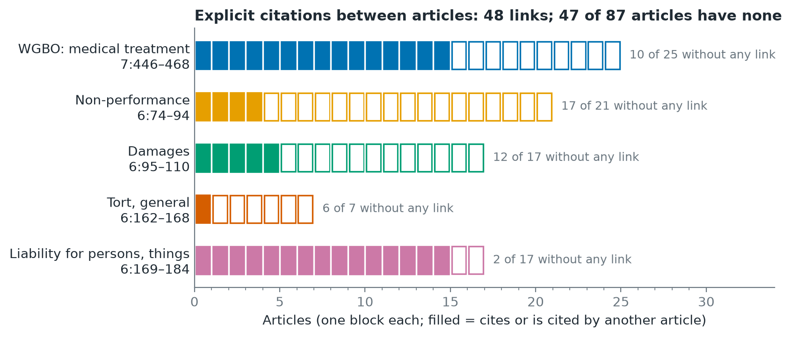

# 5. Score spreading over links between articles

## Idea

Judges tend to cite articles that belong together. If one article matches a
question strongly, its neighbours in the law are more likely to be relevant
too. So after the hybrid baseline has scored every article, each article
passes part of its score to the articles it is linked to. Still no atoms:
this tests how far the law's own structure gets us.

## Two kinds of link

- **Citations:** one article names another in its text (48 links between
  corpus articles).
- **Sections:** two articles in the same afdeling of the legal tree (803
  links). This is the structure G-DSR (Louis et al., 2023) builds on.

## How

1. Scale the RRF scores of a question to 0–1.
2. For each kind of link, add β × the (normalised) scores of the linked
   articles: s' = s + β · D^-½ A D^-½ s.

The normalisation divides by the number of links on both sides. Without it,
an article with a single link received its neighbour's full score and
jumped into the top 10 too often; that version made results worse.

β was chosen on dev by nDCG@10: 0.25 for citations, 1.0 for sections, and
0.1 + 1.0 for both together (`outputs/tables/graph_sweep_dev.csv`).

## Is the idea sound?

On dev, of 320 pairs of articles cited together, 17 are linked by citation
(5.3%, against 1.3% for random pairs) and 145 share a section (45% against
17%). So the links do point at articles judges cite together, but citation
links cover few pairs.

## Results (dev, 126 questions)

| | MRR | recall@5 | recall@10 | recall@20 | nDCG@10 |
|---|---|---|---|---|---|
| Hybrid, RRF | 0.38 | 0.31 | 0.47 | 0.66 | 0.32 |
| + spreading along citations | 0.37 | 0.35 | 0.50 | 0.63 | 0.34 |
| + spreading within sections | 0.39 | 0.32 | 0.50 | 0.69 | 0.34 |
| **+ spreading along both** | **0.41** | **0.35** | **0.50** | **0.70** | **0.35** |

Gain in nDCG@10 over RRF (paired, 95% interval, permutation p):

- both: +0.032 [+0.011, +0.053], p = 0.004
- sections: +0.017, p = 0.01
- citations: +0.018, p = 0.25 (not significant)

β was chosen on these same questions, so the gains are optimistic until the
test run.

## What it does not fix

The blind spots stay (see the figure in [4. Baselines](04_baselines.md)):
6:74 and 6:162 are still never in the top 10, and 7:453 drops to 3 of 44.
6:162 and 7:453 have no citation links at all, and a section boost lifts
all their neighbours equally. Reaching them needs links the law text does
not make explicit, such as shared actors, acts and conditions: the links
the atom graph adds.

Code: `src/graph/propagation.py`; systems `graph_cite`, `graph_tree`,
`graph_both` in `scripts/run_baselines.py`.
